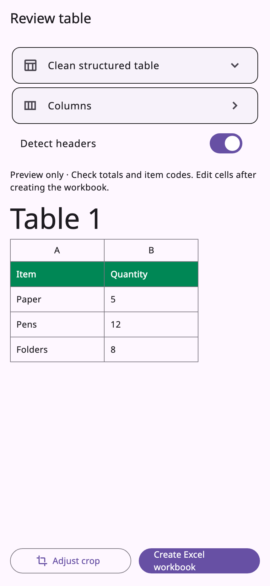
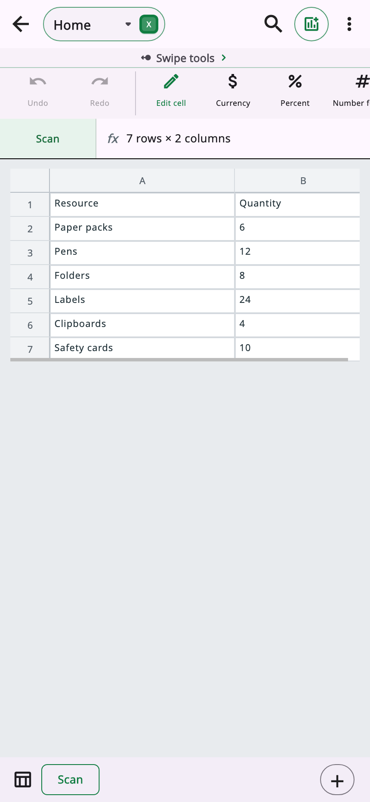

[](https://aresdefencelabs.com)

# AresExcel

[Official website](https://aresdefencelabs.com) · [GitHub repository](https://github.com/Ares-Defence-Labs/AresExcel) · [Developer documentation](docs/getting-started.md)

> **Commercial licence required.** AresExcel is licensed separately and includes its
> bundled mobile scanner. [Licensing and setup](docs/licensing.md)

**Workbooks, cells and formulas. An Excel workspace in your app.**

Read and update workbooks through cell and range APIs, embed the spreadsheet editor, or turn photographed tables, receipts and invoices into editable XLSX on Android and iOS.
Use `AresExcelSdk` for file operations, `AresExcelEditor` for the supplied workspace,
and `sdk.scanToFile` for the mobile capture-to-file workflow.

> **Pre-release documentation.** This repository contains guides and examples,
> not an installable SDK. Protected customer packages, full Microsoft feature
> parity and release acceptance remain unfinished. [Current release status](docs/release-status.md)

## Choose your workbook-editing integration

**Build your own UI:** use the [managed file APIs](docs/low-level-api.md) to load,
edit and save `.xlsx` files. Your app owns navigation, file selection and storage.

**Use the provided UI:** embed [`AresExcelEditor`](docs/editor.md), configure its
[theme and tools](docs/customization.md), and connect your [host callbacks](docs/host-callbacks.md).
On Android and iOS, add the [bundled scanner](docs/scanning.md) to create editable
files from photographed documents.

### 1. Scan a document

Launch `sdk.scanToFile` in a native Android or iOS app. Capture the page and refine
the crop before recognition. The scanner creates `.xlsx` output for AresExcel.
[Scanner integration and permissions](docs/scanning.md)

### 2. Review the recognized content

Review the recognized content and select an appropriate output template before
creating the workbook.

<a href="docs/screenshots.md"></a>

### 3. Edit and save the file

Open the generated file in `AresExcelEditor`, or use the managed APIs with your own
UI. Handle save results and errors before reporting success to your users.

<a href="docs/screenshots.md"></a>

These are actual SDK widgets rendered with synthetic fixtures. They illustrate
review and editing, not a live camera session or customer/admin licence acceptance.
[View full-size screenshots and provenance](docs/screenshots.md)

## Try AresExcel workflows in AresScan+

Explore Office document workflows in **AresScan+**, the Ares Defence Labs mobile app.

<a href="https://play.google.com/store/apps/details?id=ai.aresdefencelabs.aresscan"></a>
<a href="https://apps.apple.com/us/app/aresscan/id6759765449"></a>

[Discover AresScan+](https://aresdefencelabs.com/ares-scan) · [SDKs and pricing](https://aresdefencelabs.com/development-sdks)

## Configure your licence

After obtaining the reviewed customer distribution, construct the SDK with your
product token from private build/runtime configuration:

```dart
final sdk = AresExcelSdk(
  licenceKey: const String.fromEnvironment('ARES_OFFICE_LICENCE'),
);
```

AresExcel requires a signed `AresExcelSDK` grant. Other Office product licences do
not unlock it. Its bundled scanner needs no additional Edge licence purchase.
See [licensing](docs/licensing.md) for binding, renewal, desktop/web grants and
rejection behavior. No Office trial behavior is promised.

## Ready-made editor: AresExcelEditor

```dart
AresExcelEditor(
  sdk: sdk,
  documentPath: document.path,
  onDocumentSaved: (saved) { /* update the host with saved.document */ },
  onError: (error) { /* retain unsaved work and show an actionable error */ },
)
```

Load or import the workbook first. The host owns picker UI, writable native
paths or browser workspace storage, sharing and download actions.
[Editor lifecycle](docs/editor.md) · [Storage](docs/storage.md) · [Web integration](docs/web.md)

## Build your own UI: managed file APIs

```dart
import 'package:ares_excel/ares_excel.dart';

Future<AresOfficeSaveResult> updateAresExcel(
  AresExcelSdk sdk, String path, String copyPath,
) async {
  final original = await sdk.load(path);
  final session = await sdk.edit(original);
  try {
    // Use a supported editable fixture containing at least one section.
    session.setCell(sectionIndex: 0, row: 0, column: 0, value: 'Hello Excel!');
    return await sdk.save(session, outputPath: copyPath);
  } finally {
    session.dispose();
  }
}
```

Supply a supported existing `.xlsx` file containing at least one section and a
new writable `copyPath`. [First integration](docs/getting-started.md) covers byte
import. [Workbooks, typed cells, ranges, formulas and dates](docs/workbooks-cells-formulas.md) covers domain operations.

## Mobile scanner: capture to editable XLSX

```dart
final result = await sdk.scanToFile(
  context: context,
  outputPath: outputPath, // New writable destination ending in .xlsx.
);
if (result == null) return; // The user cancelled.
// Open result.path with AresExcelEditor or sdk.load.
```

The host handles permissions, errors and widget lifecycle. See the complete
[scan-and-edit example](examples/scan_and_edit.dart) and [scanner guide](docs/scanning.md).

## Platform requirements

| Platform | Editor and managed file APIs | Camera scanner |
| --- | --- | --- |
| Android / iOS | Targeted | Native apps only |
| macOS / Windows / Linux | Targeted | Unavailable |
| Web, including mobile browsers | Targeted | Unavailable |

These are support targets, not completed certification. See [platform setup and
verification](docs/platforms.md), [feature coverage](docs/compatibility.md) and
[release gates](docs/release-status.md). Windows runtime acceptance remains deferred.

## Supported public API

Use `package:ares_excel/ares_excel.dart` for the complete SDK, or
`package:ares_excel/scanner.dart` for scanner integration. The public declarations,
exported types and integration recipes are documented below.

- [Installation and first edit](docs/getting-started.md)
- [Integration modes and ownership](docs/architecture.md)
- [Managed file API, history and conflict handling](docs/low-level-api.md)
- [Embedded editor and lifecycle](docs/editor.md)
- [Theme, tools and controller state](docs/customization.md)
- [Host callbacks and I/O](docs/host-callbacks.md)
- [Workbooks, typed cells, ranges, formulas and dates](docs/workbooks-cells-formulas.md)
- [Defined names, notes, hyperlinks and validation](docs/names-notes-validation.md)
- [Mobile scanner and domain output](docs/scanning.md)
- [SDK, scanner and editor declarations](docs/api-reference.md)
- [Exported types and member signatures](docs/api-types.md)
- [Native files and browser storage](docs/storage.md)
- [Browser import, editing and export](docs/web.md)
- [Independent product licensing](docs/licensing.md)
- [Platform setup and verification scope](docs/platforms.md)
- [Product UI screenshots](docs/screenshots.md)
- [Runnable integration recipes](docs/example.md)
- [Migration from the combined Office engine](docs/migration.md)
- [Errors and troubleshooting](docs/troubleshooting.md)
- [Feature coverage and limits](docs/compatibility.md)
- [Security and protected assets](docs/security-and-assets.md)
- [Customer package preparation](docs/packaging.md)
- [Release and distribution process](docs/release-process.md)
- [Current release gates](docs/release-status.md)
- [Deferred Windows acceptance](docs/windows-validation.md)

## Current release and support

[Changelog](CHANGELOG.md) · [Release status](docs/release-status.md) ·
[Support](SUPPORT.md) · [Report an issue](https://github.com/Ares-Defence-Labs/AresExcel/issues) · [Security reporting](SECURITY.md)

This public repository contains documentation and support material. SDK
implementation, protected runtime, models and issuer tools remain private.
The [package blueprint](packaging/pubspec.yaml) is non-publishable; do not use
this repository as a Git dependency. [Distribution notice](NOTICE.md)
